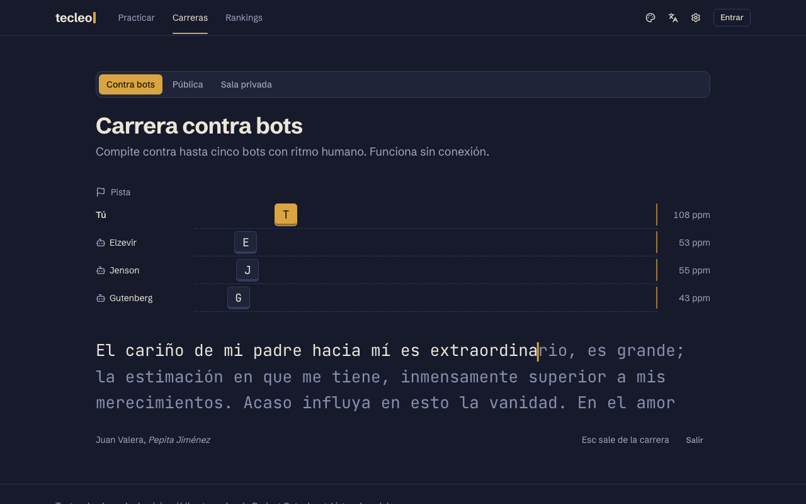
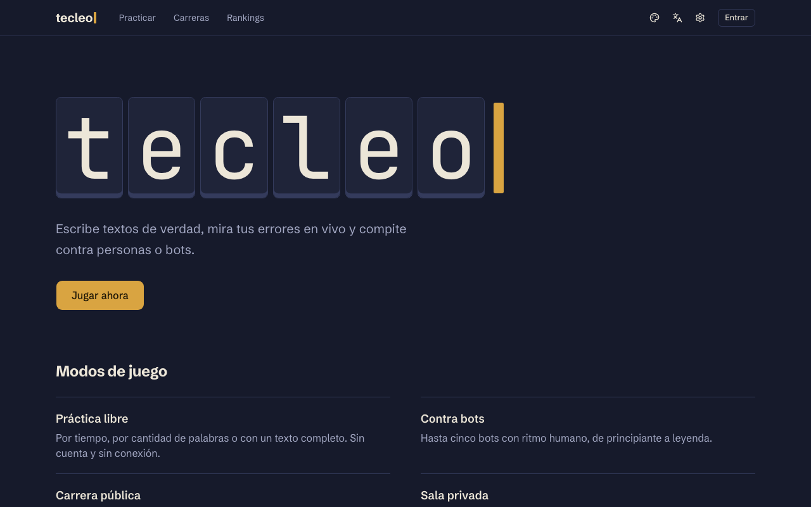
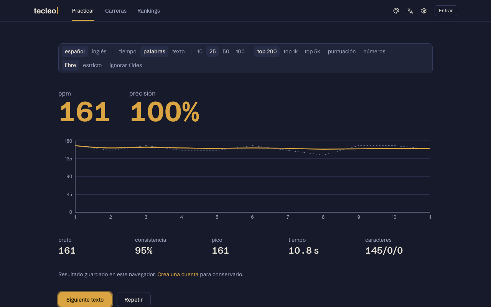
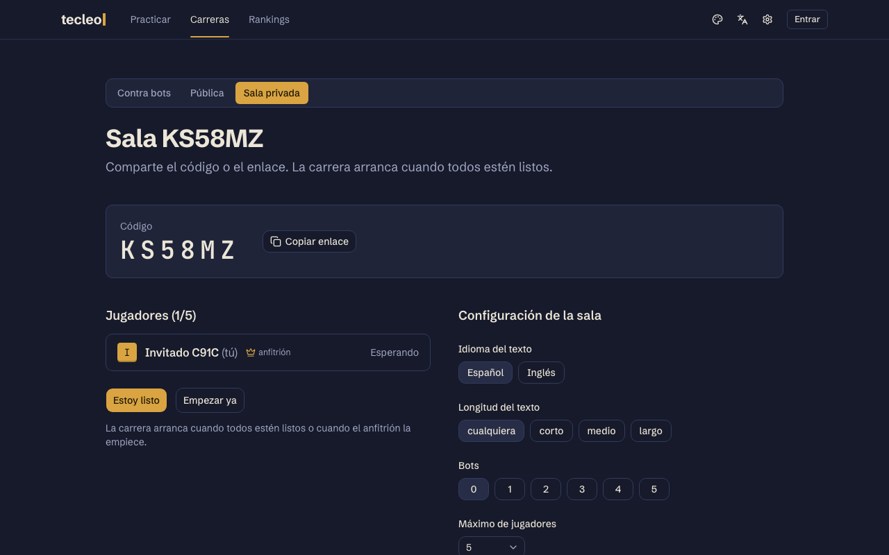
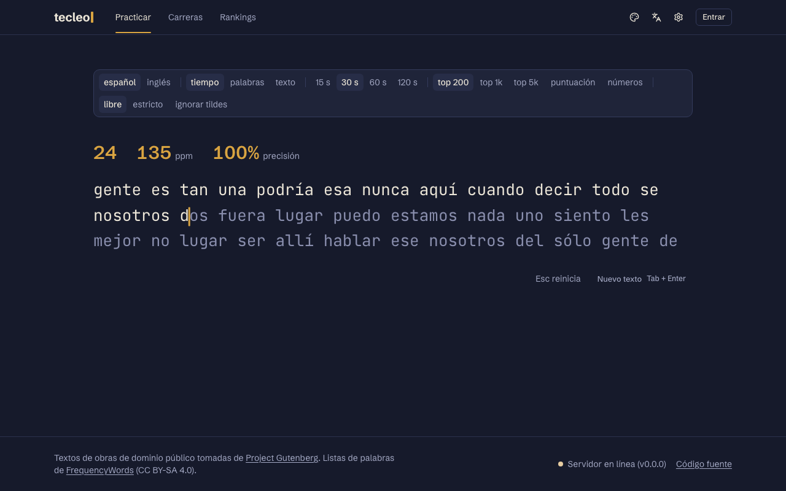
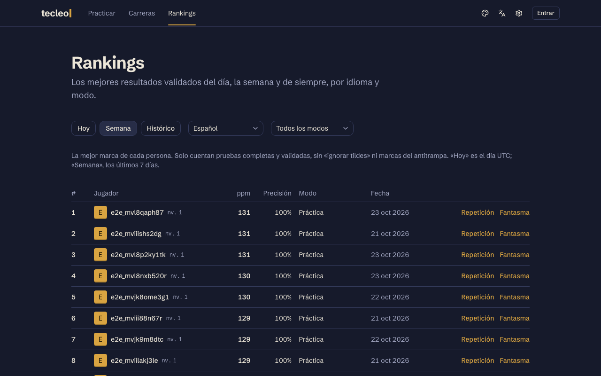
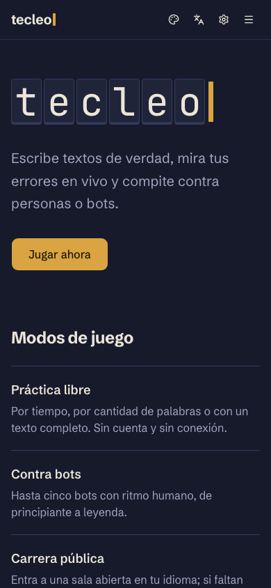
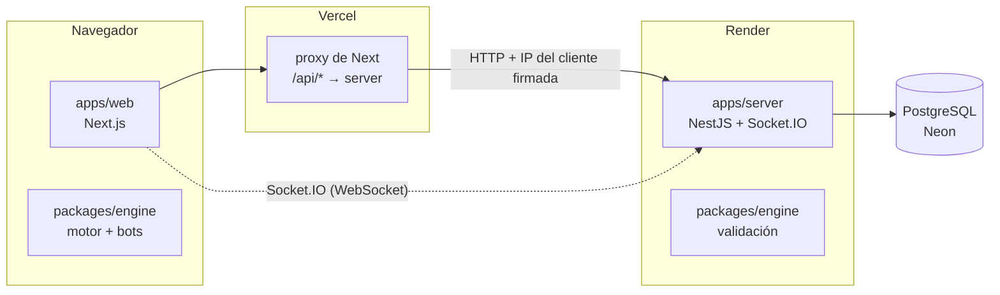

# Tecleo

Carreras de mecanografía en tiempo real contra otras personas o contra bots. Aparece un texto y lo escribes. Mientras tanto ves en vivo lo correcto, lo incorrecto y lo pendiente, y tu corredor avanza en la pista junto a los demás.

**Demo:** https://tecleo-nine.vercel.app



## Qué se puede hacer

- **Práctica libre** por tiempo, por cantidad de palabras o con un texto completo. Funciona sin cuenta y sin conexión.
- **Carrera contra bots:** de 1 a 5 bots con ritmo humano (pausas, errores que corrigen, fatiga), de principiante a leyenda.
- **Carrera pública:** entras a una sala de tu idioma; si en 10 s no llega nadie más, se completa con bots.
- **Sala privada:** un código de 6 caracteres y un enlace para compartir. El anfitrión configura la carrera y se puede pedir revancha.
- **Desafío diario:** el mismo texto para todos durante el día, con su propio ranking.
- **Carrera fantasma:** contra la repetición de cualquier resultado, tuyo o de otra persona.
- **Práctica dirigida:** ejercicios armados con las teclas y pares de letras donde más fallas.
- **Con cuenta:**
  - perfil con evolución, historial y mapa de calor sobre el teclado;
  - repeticiones pulsación por pulsación;
  - XP, niveles, 17 logros y avatares desbloqueables;
  - rankings diario, semanal e histórico.
- Español e inglés, seis temas con contraste AA, tipografías configurables y sonidos de tecla opcionales.

| Inicio                                                 | Resultados                                                      | Sala privada                                       |
| ------------------------------------------------------ | --------------------------------------------------------------- | -------------------------------------------------- |
|             |  |  |
| **Práctica**                                           | **Rankings**                                                    | **En el teléfono**                                 |
|  |                     |     |

## Correr en local

Requisitos: Node 24, pnpm 10 (`corepack enable`) y Docker.

```bash
pnpm local
```

Ese comando hace todo lo necesario:

1. Instala las dependencias.
2. Crea `apps/server/.env` y `apps/web/.env.local` a partir de [`.env.example`](.env.example), si no existen.
3. Levanta Postgres con Docker.
4. Aplica las migraciones y carga los 335 textos.
5. Arranca todo en modo desarrollo.

Después, `pnpm dev` alcanza.

- Web: http://localhost:3100 (redirige a `/es` o `/en`).
- API: http://localhost:4100 · Swagger: http://localhost:4100/docs.

## Arquitectura



Es un monorepo con pnpm workspaces y Turborepo:

| Paquete            | Qué es                                                                                                   |
| ------------------ | -------------------------------------------------------------------------------------------------------- |
| `apps/web`         | Next.js 16 (App Router, Cache Components), Tailwind 4, shadcn/ui, Zustand, TanStack Query, next-intl.    |
| `apps/server`      | NestJS 12, Prisma 7 (Postgres), Socket.IO, Swagger.                                                      |
| `packages/engine`  | Motor de escritura en TypeScript puro: estado, métricas, reproducción de pulsaciones, antitrampa y bots. |
| `packages/shared`  | Contratos con Zod: API REST, eventos de tiempo real, progresión.                                         |
| `packages/content` | Corpus de dominio público, listas de palabras, fragmentos de código y generadores.                       |
| `e2e`              | Playwright, Lighthouse y las capturas de este README.                                                    |

El motor es la única fuente de verdad. El navegador lo usa para jugar; el servidor, para validar cada resultado: reproduce las pulsaciones y regenera los bots con la misma semilla.

En multijugador el servidor es autoritativo: decide la salida, el orden de llegada y los resultados. El cliente sincroniza el reloj por ping e interpola a los rivales.

Las decisiones y sus porqués están en [`docs/decisiones.md`](docs/decisiones.md).

## Calidad

```bash
pnpm check        # formato, lint, typecheck y tests (Vitest)
pnpm build
pnpm e2e          # Playwright; la primera vez: pnpm --filter @tecleo/e2e exec playwright install chromium
pnpm lighthouse   # con la web en marcha: mediana de 3 corridas, ≥ 90 en rendimiento y accesibilidad
```

- **Tests unitarios y de integración:** motor y bots, contratos, servidor contra una base de prueba, y el gateway de sockets con sockets reales.
- **E2E:**
  - práctica, carreras, cuentas y multijugador (dos navegadores en la misma sala, reconexión y matchmaking);
  - progresión, rankings, fantasma, desafío diario, práctica dirigida y panel de textos;
  - responsive en un teléfono y fluidez al escribir.
- **Accesibilidad:** axe (WCAG 2.1 AA) revisa todas las pantallas.
- **CI:** todo corre en GitHub Actions en cada push.

## Despliegue

El despliegue es gratuito: web en Vercel, server en Render y Postgres en Neon. Los pasos están en [`docs/despliegue.md`](docs/despliegue.md); el server se describe en [`render.yaml`](render.yaml).

## Documentación

- [`docs/spec.md`](docs/spec.md): especificación del producto.
- [`docs/plan.md`](docs/plan.md): plan técnico aprobado.
- [`docs/decisiones.md`](docs/decisiones.md): decisiones tomadas en el camino.
- [`CLAUDE.md`](CLAUDE.md): comandos, convenciones y estado de cada fase.

## Créditos de contenido

- **Citas:** obras de dominio público de [Project Gutenberg](https://www.gutenberg.org/). Cada texto guarda su autor, su obra y su ID de Gutenberg.
- **Listas de palabras:** [FrequencyWords](https://github.com/hermitdave/FrequencyWords), de Hermit Dave, bajo licencia CC BY-SA 4.0.
- **Fragmentos de código:** escritos para el proyecto.
