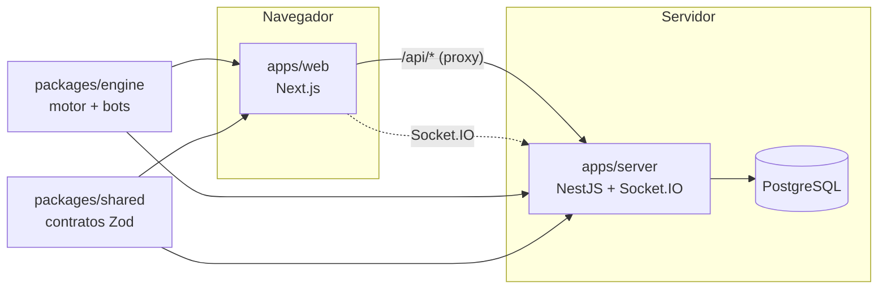

# Tecleo

Carreras de mecanografía en tiempo real contra otras personas o contra bots. Aparece un texto, lo escribes y ves en vivo lo correcto, lo incorrecto y lo pendiente mientras tu corredor avanza en la pista junto a los demás.

> Estado: **Fase 0 (base del proyecto)**. Todavía no se puede jugar; ver el estado de cada fase en [`CLAUDE.md`](CLAUDE.md).

## Correr en local

Requisitos: Node 24, pnpm 10 (`corepack enable`), Docker.

```bash
pnpm install
pnpm db:up
pnpm dev
```

- Web: http://localhost:3100
- API: http://localhost:4100 · Swagger: http://localhost:4100/docs

Las variables de entorno tienen valores por defecto para desarrollo; ver [`.env.example`](.env.example) para cambiarlas.

## Arquitectura



Monorepo con pnpm workspaces y Turborepo. El motor de escritura (`packages/engine`) es la única fuente de verdad de la lógica de escritura y las métricas: lo usan el navegador para jugar y el server para validar resultados y simular bots.

## Calidad

```bash
pnpm check   # formato, lint, typecheck y tests
pnpm build
```

El mismo flujo corre en GitHub Actions en cada push y PR.

## Documentación

- [`docs/spec.md`](docs/spec.md): especificación del producto.
- [`docs/plan.md`](docs/plan.md): plan técnico aprobado.
- [`docs/decisiones.md`](docs/decisiones.md): decisiones tomadas en el camino.
